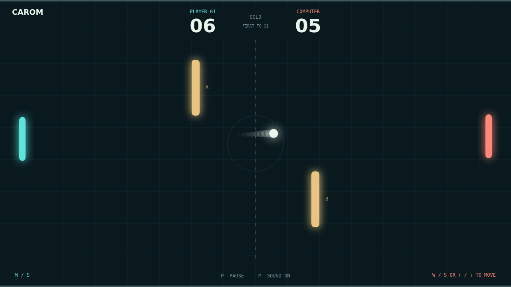

# Carom

One ball. Two paddles. A whole field of possibilities. Carom is a quick arcade
duel where every return is a chance to find a new angle. Challenge the computer
in Solo or go head to head with a friend on the same keyboard.

The opening serve gives you a moment to line up. Meet it squarely for a straight
return, or catch it near the end of your paddle to send it climbing toward a
wall. Each paddle hit raises the pace, turning a measured exchange into a test
of timing.

Move as you strike and the ball starts to curve. Spin carries through bounces,
so the two gold obstacles can become the setup for a sneaky bank shot. A return
that looked safe can bend into a very different problem.

Race to eleven, but keep your nerve: you need a two-point lead to finish the
match. At ten-all, every save buys another chance to send the perfect reply.

